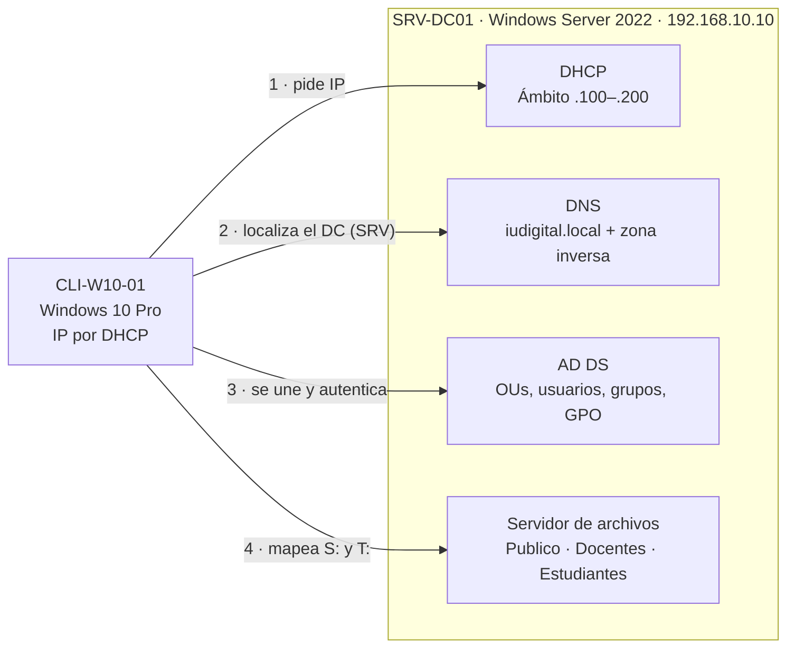

# Guía de laboratorio: AD DS, DNS y DHCP en Windows Server 2022 con clientes Windows 10

**Autor:** Estudiante · Ingeniería de Software y Datos · IU Digital de Antioquia
**Fecha:** 16 de noviembre de 2026

---

## Contenido

- [1. Objetivo y topología del laboratorio](#1-objetivo-y-topología-del-laboratorio)
  - [1.1 Topología y valores del laboratorio](#11-topología-y-valores-del-laboratorio)
  - [1.2 Requisitos de las máquinas virtuales](#12-requisitos-de-las-máquinas-virtuales)
  - [1.3 Red de las VM: misma red interna, sin el DHCP del hipervisor](#13-red-de-las-vm-misma-red-interna-sin-el-dhcp-del-hipervisor)
- [2. Preparación del servidor](#2-preparación-del-servidor)
  - [2.1 Nombre, IP fija, DNS y zona horaria](#21-nombre-ip-fija-dns-y-zona-horaria)
  - [2.2 Comprobación](#22-comprobación)
- [3. Instalación de AD DS y promoción a controlador de dominio](#3-instalación-de-ad-ds-y-promoción-a-controlador-de-dominio)
  - [3.1 Instalar el rol](#31-instalar-el-rol)
  - [3.2 Promover a controlador de dominio](#32-promover-a-controlador-de-dominio)
- [4. Configuración de DNS](#4-configuración-de-dns)
  - [4.1 Revisar la zona directa](#41-revisar-la-zona-directa)
  - [4.2 Crear la zona inversa](#42-crear-la-zona-inversa)
  - [4.3 Crear el PTR del servidor](#43-crear-el-ptr-del-servidor)
  - [4.4 Reenviadores (opcional)](#44-reenviadores-opcional)
- [5. Instalación y configuración de DHCP](#5-instalación-y-configuración-de-dhcp)
  - [5.1 Instalar el rol y autorizarlo](#51-instalar-el-rol-y-autorizarlo)
  - [5.2 Crear el ámbito](#52-crear-el-ámbito)
- [6. Estructura de Active Directory: OUs, usuarios y grupos](#6-estructura-de-active-directory-ous-usuarios-y-grupos)
  - [6.1 Diseño de la estructura](#61-diseño-de-la-estructura)
  - [6.2 Crear las OU, los grupos y los usuarios](#62-crear-las-ou-los-grupos-y-los-usuarios)
- [7. Recursos compartidos: carpetas y permisos](#7-recursos-compartidos-carpetas-y-permisos)
  - [7.1 Permisos por carpeta](#71-permisos-por-carpeta)
  - [7.2 Crear y compartir las carpetas](#72-crear-y-compartir-las-carpetas)
- [8. Políticas de seguridad con GPO](#8-políticas-de-seguridad-con-gpo)
  - [8.1 GPO del laboratorio](#81-gpo-del-laboratorio)
  - [8.2 Contraseñas, restricciones y seguridad del equipo](#82-contraseñas-restricciones-y-seguridad-del-equipo)
  - [8.3 Mapeo de unidades (solo interfaz gráfica)](#83-mapeo-de-unidades-solo-interfaz-gráfica)
- [9. Unir el cliente Windows 10 al dominio](#9-unir-el-cliente-windows-10-al-dominio)
  - [9.1 Comprobar la red](#91-comprobar-la-red)
  - [9.2 Unir el cliente al dominio](#92-unir-el-cliente-al-dominio)
  - [9.3 Mover el equipo a su OU (en el servidor)](#93-mover-el-equipo-a-su-ou-en-el-servidor)
  - [9.4 Iniciar sesión con un usuario del dominio](#94-iniciar-sesión-con-un-usuario-del-dominio)
- [10. Verificación final](#10-verificación-final)
  - [10.1 Active Directory (en el servidor)](#101-active-directory-en-el-servidor)
  - [10.2 DNS con nslookup (en el cliente)](#102-dns-con-nslookup-en-el-cliente)
  - [10.3 DHCP](#103-dhcp)
  - [10.4 Cliente conectado al dominio](#104-cliente-conectado-al-dominio)
  - [10.5 GPO aplicadas](#105-gpo-aplicadas)
  - [10.6 Recursos compartidos](#106-recursos-compartidos)
  - [10.7 Evidencias para el informe (capturas propias)](#107-evidencias-para-el-informe-capturas-propias)
- [11. Solución de problemas comunes](#11-solución-de-problemas-comunes)
- [12. Fuentes de las capturas](#12-fuentes-de-las-capturas)

---

## Cómo usar esta guía

| Marca | Qué identifica | Ejemplo |
| --- | --- | --- |
| `N.` | Sección | **4.** Configuración de DNS |
| `N.M` | Paso de la sección | **4.2** Crear la zona inversa |
| `N.Ma` · `N.Mb` · `N.Mc` | Alternativas para el **mismo** paso: haz **solo una** | **4.2a** PowerShell · **4.2b** Interfaz gráfica |
| `N.Mx.1` · `N.Mx.2` | Opciones dentro de una alternativa (solo en 1.3b y 1.3c) | **1.3b.1** Segmento LAN · **1.3b.2** VMnet1 |
| `N.Mx.K` | Instrucción K dentro de un paso, una alternativa o una opción: su número empieza por el del título que la contiene | **4.2b.3** dentro de 4.2b · **1.3b.1.2** dentro de 1.3b.1 |
| `10.7.K` | Evidencia para el informe | **10.7.3** Consola DHCP · **10.7.7.2** su segunda instrucción |

- En las secciones 2 a 9, la opción **a** es siempre **PowerShell** y la **b**, la **interfaz gráfica**. En la sección 1.3, las letras son los hipervisores: **a** VirtualBox, **b** VMware Workstation y **c** Hyper-V.
- Cada sección tiene **su propio color**, que se repite en sus pasos, alternativas, viñetas, tablas y bloques de código. Los colores, tamaños y márgenes se ven en la **vista previa de VS Code** (`Ctrl+Shift+V`, o `Ctrl+K V` para verla al lado del texto) y se adaptan al tema claro u oscuro.
- Los bloques de código se copian tal cual; solo cambia lo que el texto indique (por ejemplo, los nombres de tus VM).

> **Sobre las capturas de pantalla.** Las imágenes de este documento son capturas reales publicadas por terceros (Microsoft Learn, ActiveDirectoryPro, TechDirectArchive, TechLoris, Windows OS Hub, Netwrix, LayerStack, SysOps Ledger y, para la red de las VM, NAKIVO y SysNetTech Solutions). **No se copiaron**: el Markdown las enlaza desde su sitio original y cada una lleva su fuente debajo. Pertenecen a sus autores y se usan solo como referencia de estudio.
>
> - Casi todas las capturas están en **inglés**, y algunas de Microsoft Learn son de versiones anteriores del mismo asistente. Las ventanas de Windows Server 2022 en español tienen los mismos campos y en el mismo orden. Debajo de cada imagen se indica el texto equivalente en español.
> - Los nombres de dominio y las IP de las capturas son los del autor de cada tutorial. **Usa siempre los de la tabla de la sección 1.1.**
> - **Verificación (16/11/2026):** se abrieron en un navegador las 72 imágenes y se comprobó que cada una muestra el paso o el resultado descrito en su pie. Cuando una captura difiere de este laboratorio (por ejemplo, un DNS 8.8.8.8, otra versión de Windows Server o una opción distinta marcada), el pie lo indica.
> - **Dónde se ven:** en la prueba cargaron todas, tanto pidiéndolas desde otro sitio web como sin indicar la página de origen, así que deberían verse en GitHub, VS Code, Typora, Obsidian o publicadas en una página web. Algunas (ActiveDirectoryPro, NAKIVO, SysNetTech y Windows OS Hub) están en formato WebP, que todos esos visores admiten. Si una imagen se moviera en el futuro, abre el enlace de la fuente que aparece debajo.
> - Las capturas que entregues como evidencia (sección 10.7) deben ser **de tu propio laboratorio**.
---

## 1. Objetivo y topología del laboratorio

Al terminar tendrás un controlador de dominio `SRV-DC01` que presta AD DS, DNS y DHCP al dominio `iudigital.local`. Tendrás también un cliente Windows 10 unido al dominio, una carpeta compartida con permisos por grupo y políticas de seguridad aplicadas por GPO.

### 1.1 Topología y valores del laboratorio



*Figura 1. Topología del laboratorio: un solo servidor con cuatro roles y un cliente en la red interna 192.168.10.0/24. Diagrama propio en Mermaid; se dibuja en GitHub, GitLab, Obsidian y Typora. En VS Code, si ves el código en lugar del diagrama, instala la extensión *Markdown Preview Mermaid Support*.*

| Elemento | Valor de ejemplo | Notas |
| --- | --- | --- |
| Dominio (FQDN) | `iudigital.local` | Usa `.local` o `.lab`, nunca un dominio público real |
| Nombre NetBIOS | `IUDIGITAL` | Se genera al promover el servidor |
| Red | `192.168.10.0/24` | Máscara 255.255.255.0 |
| Servidor | `SRV-DC01` · `192.168.10.10` (fija) | AD DS + DNS + DHCP + archivos |
| Puerta de enlace | `192.168.10.1` | Déjala vacía si tu red interna no tiene router |
| DNS de los clientes | `192.168.10.10` | Siempre el DC, nunca 8.8.8.8 |
| Ámbito DHCP | `192.168.10.100` – `192.168.10.200` | Exclusión: .100 – .110 |
| Cliente | `CLI-W10-01` · IP por DHCP | Windows 10 Pro, Education o Enterprise; la edición Home no se une a dominios |
| Usuarios de prueba | `bienestaru`, `jdocente` | En la OU Usuarios |

### 1.2 Requisitos de las máquinas virtuales

- Windows Server 2022 Standard o Datacenter con **Experiencia de escritorio**: 2 vCPU, 4 GB de RAM y 50 GB de disco.
- Windows 10 Pro: 2 vCPU, 2–4 GB de RAM y 40 GB de disco.
- Las dos VM en la **misma red interna** y **sin el DHCP del hipervisor** en esa red. Cómo hacerlo en cada hipervisor: sección 1.3.
- Toma una **instantánea (snapshot)** antes de empezar y después de cada sección.

### 1.3 Red de las VM: misma red interna, sin el DHCP del hipervisor

El servidor `SRV-DC01` y el cliente `CLI-W10-01` deben quedar conectados al **mismo conmutador virtual aislado**. Ese conmutador no debe repartir direcciones: el único DHCP de la red será el de Windows Server (sección 5). Si el hipervisor también entrega IP, el cliente puede recibir una dirección y un DNS que no son los del laboratorio, y entonces no encuentra el dominio.

| Hipervisor | Modo de red que debes usar | ¿Trae DHCP? | Qué hacer |
| --- | --- | --- | --- |
| VirtualBox | **Red interna** (`intnet`) | No | Elegir el mismo nombre de red interna en las dos VM |
| VMware Workstation | **Segmento LAN** (por ejemplo `LAN-IUDigital`) | No | Crear el segmento y asignarlo a las dos VM. Alternativa: *Host-only* (VMnet1) **desmarcando** su DHCP |
| Hyper-V | **Conmutador virtual privado** (o interno) | No | Crear el conmutador y conectar las dos VM. **No uses** *Default Switch*: trae NAT y DHCP |

Elige **solo la opción de tu hipervisor** (1.3a, 1.3b o 1.3c). Usa **un solo adaptador de red por VM** durante el laboratorio. Si el servidor necesita Internet un momento (por ejemplo, para actualizaciones), agrégale un adaptador NAT, actualiza y vuelve a quitarlo: con dos adaptadores, el controlador de dominio registra las dos IP en DNS y el cliente puede recibir la equivocada.

#### 1.3a — VirtualBox: red interna

- <span class="paso">1.3a.1</span> Con la VM **apagada**: **Configuración → Red → Adaptador 1** → marca **Habilitar adaptador de red**.
- <span class="paso">1.3a.2</span> En **Conectado a**, elige **Red interna**.


*Figura 2. Lista **Attached to** (*Conectado a*) del adaptador 1: elige **Internal Network** (*Red interna*). No elijas *NAT*, *Red NAT* ni *Adaptador solo-anfitrión*, porque esos modos traen DHCP. Fuente: [NAKIVO — VirtualBox Network Settings: All You Need to Know](https://www.nakivo.com/blog/virtualbox-network-setting-guide/). Interfaz en inglés.*

- <span class="paso">1.3a.3</span> En **Nombre** deja `intnet` (o escribe otro, pero **idéntico** en las dos VM) → **Aceptar**. Repite los pasos 1.3a.1 a 1.3a.3 en la otra VM.


*Figura 3. <mark>ACTUALIZAR IMAGEN</mark> Adaptador 1 configurado: **Conectado a** = **Red interna** y **Nombre** = **intnet**.*

- <span class="paso">1.3a.4</span> **Comprobación:** arranca las VM antes de poner IP fija y ejecuta `ipconfig`. Debe salir una dirección `169.254.x.x` (APIPA): eso prueba que en la red interna **nadie** reparte IP. Después pon la IP fija del servidor (sección 2.1); el cliente recibirá su IP del DHCP de Windows Server (sección 9).


*Figura 4. <mark>ACTUALIZAR IMAGEN</mark> **Detalles de la conexión de red** en una VM conectada a la red interna: *DHCP habilitado = Sí*, pero la dirección es **169.254.x.x** porque no hay servidor DHCP.*

Las redes internas de VirtualBox no traen DHCP. Si alguna vez creaste uno con `VBoxManage dhcpserver add`, el comando `VBoxManage list dhcpservers` lo muestra; elimínalo con `VBoxManage dhcpserver remove --network=intnet`.

#### 1.3b — VMware Workstation

##### 1.3b.1 — Segmento LAN (recomendado)

- <span class="paso">1.3b.1.1</span> Con la VM apagada: **VM → Settings → Network Adapter** (*Adaptador de red*) → opción **LAN segment** (*Segmento LAN*) → botón **LAN Segments…**.


*Figura 5. Configuración de la VM en VMware Workstation: adaptador de red seleccionado y botón **LAN Segments…** marcado. Fuente: [SysNetTech Solutions — VMware LAN Segment Configuration Guide](https://www.sysnettechsolutions.com/en/vmware-lan-segment-configuration-guide/). Interfaz en inglés.*

- <span class="paso">1.3b.1.2</span> En **Global LAN Segments** haz clic en **Add** (*Agregar*).


*Figura 6. Ventana **Global LAN Segments** vacía con el botón **Add**. Fuente: [SysNetTech Solutions](https://www.sysnettechsolutions.com/en/vmware-lan-segment-configuration-guide/).*

- <span class="paso">1.3b.1.3</span> Escribe el nombre del segmento, por ejemplo `LAN-IUDigital` → **OK**.


*Figura 7. Segmento creado y nombrado; en tu laboratorio, `LAN-IUDigital`. Fuente: [SysNetTech Solutions](https://www.sysnettechsolutions.com/en/vmware-lan-segment-configuration-guide/).*

- <span class="paso">1.3b.1.4</span> De vuelta en el adaptador, marca **LAN segment** y elige el segmento en la lista → **OK**. Repite el paso 1.3b.1.4 en la otra VM con **el mismo** segmento.


*Figura 8. Adaptador conectado al **LAN segment** elegido en la lista. Un segmento LAN no tiene DHCP: hasta poner IP fija, Windows mostrará una dirección 169.254.x.x. Fuente: [SysNetTech Solutions](https://www.sysnettechsolutions.com/en/vmware-lan-segment-configuration-guide/).*

##### 1.3b.2 — Red solo-anfitrión VMnet1 sin DHCP (alternativa)

Abre **Edit → Virtual Network Editor** (*Editar → Editor de red virtual*) → **Change Settings** (pide permisos de administrador) → selecciona **VMnet1 (Host-only)** → **desmarca** *Use local DHCP service to distribute IP address to VMs* → **Apply**. Luego, en cada VM: **Network Adapter → Custom → VMnet1**.


*Figura 9. **Virtual Network Editor** con **VMnet1 (Host-only)** seleccionada. En la captura la casilla **Use local DHCP service…** está **marcada** (columna DHCP = *Enabled*); **en tu laboratorio desmárcala** para que la columna diga *Disabled*. Fuente: [SysNetTech Solutions — VMware Workstation Host-Only Network](https://www.sysnettechsolutions.com/en/vmware-workstation-host-only-network/). Interfaz en inglés.*

#### 1.3c — Hyper-V: conmutador virtual privado

##### 1.3c.1 — PowerShell (en el anfitrión, como administrador)

Cambia los nombres de las VM por los tuyos.

```powershell
New-VMSwitch -Name "LAN-IUDigital" -SwitchType Private
Connect-VMNetworkAdapter -VMName "SRV-DC01","CLI-W10-01" -SwitchName "LAN-IUDigital"
```

##### 1.3c.2 — Interfaz gráfica (alternativa)

- <span class="paso">1.3c.2.1</span> En el equipo anfitrión abre el **Administrador de Hyper-V** → panel *Acciones* → **Administrador de conmutadores virtuales**.


*Figura 10. Panel **Actions** (*Acciones*) del Administrador de Hyper-V → **Virtual Switch Manager…** (*Administrador de conmutadores virtuales*). Fuente: [SysNetTech Solutions — Create Internal Virtual Switch in Hyper-V](https://www.sysnettechsolutions.com/en/create-and-configure-internal-virtual-switch-in-hyper-v-manager/). Interfaz en inglés.*

- <span class="paso">1.3c.2.2</span> **Nuevo conmutador de red virtual** → elige **Privado** → **Crear conmutador virtual**.


*Figura 11. Tipos de conmutador: *External*, *Internal* y *Private* (*Externo*, *Interno*, *Privado*). En la captura está seleccionado **Internal**; en tu laboratorio elige **Private**, que conecta solo las VM entre sí. *Internal* también sirve (agrega al anfitrión) y tampoco trae DHCP. Fuente: [SysNetTech Solutions](https://www.sysnettechsolutions.com/en/create-and-configure-internal-virtual-switch-in-hyper-v-manager/).*

- <span class="paso">1.3c.2.3</span> Escribe el nombre (por ejemplo `LAN-IUDigital`), comprueba que el tipo de conexión sea **Red privada** → **Aceptar**.


*Figura 12. **Propiedades del conmutador virtual**: nombre y tipo de conexión. En la captura el tipo es *Internal network*; en tu laboratorio marca **Private network** (*Red privada*). Fuente: [SysNetTech Solutions](https://www.sysnettechsolutions.com/en/create-and-configure-internal-virtual-switch-in-hyper-v-manager/).*

- <span class="paso">1.3c.2.4</span> En cada VM (apagada): **Configuración → Adaptador de red → Conmutador virtual** → elige `LAN-IUDigital` → **Aceptar**.


*Figura 13. **Configuración de la VM → Network Adapter → Virtual switch** (*Adaptador de red → Conmutador virtual*): se elige el conmutador creado. Haz lo mismo en las dos VM. Fuente: [SysNetTech Solutions](https://www.sysnettechsolutions.com/en/create-and-configure-internal-virtual-switch-in-hyper-v-manager/).*

---

## 2. Preparación del servidor

Un controlador de dominio necesita IP fija, un nombre definitivo y su propia IP como DNS antes de instalar cualquier rol.

### 2.1 Nombre, IP fija, DNS y zona horaria

#### 2.1a — PowerShell (como administrador)

```powershell
Get-NetAdapter   # nombre del adaptador, normalmente "Ethernet"
New-NetIPAddress -InterfaceAlias "Ethernet" -IPAddress 192.168.10.10 -PrefixLength 24 -DefaultGateway 192.168.10.1
Set-DnsClientServerAddress -InterfaceAlias "Ethernet" -ServerAddresses 127.0.0.1
Set-TimeZone -Id "SA Pacific Standard Time"
Rename-Computer -NewName "SRV-DC01" -Restart
```

#### 2.1b — Interfaz gráfica (alternativa)

- <span class="paso">2.1b.1</span> **Administrador del servidor → Servidor local** → clic en el nombre del equipo → **Cambiar** → `SRV-DC01`. No reinicies todavía.
- <span class="paso">2.1b.2</span> Clic en la tarjeta **Ethernet** → clic derecho sobre el adaptador → **Propiedades** → **Protocolo de Internet versión 4 (TCP/IPv4)** → **Propiedades**.
- <span class="paso">2.1b.3</span> Marca **Usar la siguiente dirección IP** y escribe: IP `192.168.10.10`, máscara `255.255.255.0` y puerta de enlace `192.168.10.1`. En **Servidor DNS preferido** escribe `127.0.0.1`.
- <span class="paso">2.1b.4</span> Zona horaria **(UTC-05:00) Bogotá, Lima, Quito** y reinicia.


*Figura 14. Ventana **Propiedades de Ethernet** en Windows Server 2022: selecciona **Protocolo de Internet versión 4 (TCP/IPv4)** y haz clic en **Propiedades** (paso 2.1b.2). La ventana que se abre es la de la figura 56, donde escribes los valores del paso 2.1b.3. La captura es de un servidor en la nube (adaptador *Red Hat VirtIO*); en tu VM el adaptador tendrá otro nombre. Es igual en Windows 10. Fuente: [LayerStack — Static IP Address on Windows Server 2022](https://www.layerstack.com/resources/tutorials/How-to-configure-the-Static-IP-Address-Network-Card-for-Windows-2022-Cloud-Servers). Interfaz en inglés.*

### 2.2 Comprobación

`ipconfig /all` debe mostrar `SRV-DC01`, la IP `192.168.10.10` y **DHCP habilitado: No**.

---

## 3. Instalación de AD DS y promoción a controlador de dominio

Al promover el servidor como primer DC de un bosque nuevo, el asistente instala y configura DNS solo, con la zona `iudigital.local` integrada en AD.

### 3.1 Instalar el rol

#### 3.1a — PowerShell (como administrador)

```powershell
Install-WindowsFeature AD-Domain-Services -IncludeManagementTools
```

#### 3.1b — Interfaz gráfica (alternativa)

- <span class="paso">3.1b.1</span> **Administrador del servidor → Administrar → Agregar roles y características**.


*Figura 15. **Panel** del Administrador del servidor → **2 Add roles and features** (*Agregar roles y características*); también está en **Administrar → Agregar roles y características**. Fuente: [ActiveDirectoryPro — Install AD DS](https://activedirectorypro.com/install-ad-ds/). Interfaz en inglés.*

- <span class="paso">3.1b.2</span> Elige **Instalación basada en características o en roles** y selecciona `SRV-DC01`.
- <span class="paso">3.1b.3</span> Marca **Servicios de dominio de Active Directory** y, en la ventana emergente, haz clic en **Agregar características**.


*Figura 16. Página **Roles de servidor**: la flecha señala *Active Directory Domain Services* (*Servicios de dominio de Active Directory*). Al marcar la casilla se abre la ventana de la figura 17. Fuente: [ActiveDirectoryPro — Install AD DS](https://activedirectorypro.com/install-ad-ds/).*


*Figura 17. Ventana emergente de herramientas de administración: haz clic en **Add Features** (*Agregar características*). Fuente: [ActiveDirectoryPro — Install AD DS](https://activedirectorypro.com/install-ad-ds/).*

- <span class="paso">3.1b.4</span> Haz clic en **Siguiente** hasta llegar a **Confirmación** y luego en **Instalar**.


*Figura 18. Página **Confirmar selecciones de instalación** → **Install** (*Instalar*). Fuente: [ActiveDirectoryPro — Install AD DS](https://activedirectorypro.com/install-ad-ds/).*

### 3.2 Promover a controlador de dominio

#### 3.2a — PowerShell (como administrador)

```powershell
Install-ADDSForest `
  -DomainName "iudigital.local" -DomainNetbiosName "IUDIGITAL" `
  -ForestMode "WinThreshold" -DomainMode "WinThreshold" -InstallDns `
  -SafeModeAdministratorPassword (Read-Host -AsSecureString "Contraseña DSRM") -Force
```

`WinThreshold` es el nivel funcional **Windows Server 2016**, el más alto disponible en Windows Server 2022. El servidor se reinicia solo al terminar.

#### 3.2b — Interfaz gráfica (alternativa)

- <span class="paso">3.2b.1</span> Al terminar, haz clic en la bandera amarilla → **Promover este servidor a controlador de dominio**.


*Figura 19. Al terminar la instalación aparece el enlace **Promote this server to a domain controller** (*Promover este servidor a controlador de dominio*). Fuente: [Microsoft Learn — Install Active Directory Domain Services](https://learn.microsoft.com/en-us/windows-server/identity/ad-ds/deploy/install-active-directory-domain-services--level-100-).*

- <span class="paso">3.2b.2</span> **Configuración de implementación:** marca **Agregar un nuevo bosque** y escribe `iudigital.local` como nombre de dominio raíz.


*Figura 20. **Configuración de implementación** con *Add a new forest* (*Agregar un nuevo bosque*). Escribe `iudigital.local` en lugar del dominio de la captura. Fuente: [ActiveDirectoryPro — Install AD DS](https://activedirectorypro.com/install-ad-ds/).*

- <span class="paso">3.2b.3</span> **Opciones del controlador de dominio:** deja los niveles funcionales en **Windows Server 2016**, que es el más alto disponible en 2022. Deja marcados **Servidor DNS** y **Catálogo global**, y escribe la contraseña **DSRM**.


*Figura 21. **Opciones del controlador de dominio**: *DNS server* y *Global Catalog* marcados y contraseña DSRM. La captura es de Windows Server 2025 y por eso muestra el nivel funcional *Windows Server 2025*; **en Windows Server 2022 el más alto es Windows Server 2016**. Fuente: [ActiveDirectoryPro — Install AD DS](https://activedirectorypro.com/install-ad-ds/).*


*Figura 22. La misma página en la documentación oficial (*New forest options*). Fuente: [Microsoft Learn — AD DS Configuration Wizard page descriptions](https://learn.microsoft.com/en-us/windows-server/identity/ad-ds/deploy/ad-ds-installation-and-removal-wizard-page-descriptions#domain-controller-options).*

- <span class="paso">3.2b.4</span> **Opciones de DNS:** la advertencia sobre la delegación es normal en un laboratorio; continúa.


*Figura 23. **Opciones de DNS**, con el aviso de delegación: es normal en un laboratorio, continúa. Fuente: [ActiveDirectoryPro — Install AD DS](https://activedirectorypro.com/install-ad-ds/).*

- <span class="paso">3.2b.5</span> **Opciones adicionales:** confirma el NetBIOS `IUDIGITAL`.


*Figura 24. **Opciones adicionales**: el nombre NetBIOS se completa solo; en tu laboratorio será `IUDIGITAL`. Fuente: [ActiveDirectoryPro — Install AD DS](https://activedirectorypro.com/install-ad-ds/).*

- <span class="paso">3.2b.6</span> **Rutas de acceso:** deja `C:\Windows\NTDS` y `C:\Windows\SYSVOL`.


*Figura 25. **Rutas de acceso** predeterminadas: `C:\Windows\NTDS` y `C:\Windows\SYSVOL`. Fuente: [ActiveDirectoryPro — Install AD DS](https://activedirectorypro.com/install-ad-ds/).*

- <span class="paso">3.2b.7</span> **Comprobación de requisitos previos** → **Instalar**. El servidor se reinicia solo; después entra como `IUDIGITAL\Administrador`.


*Figura 26. **Comprobación de requisitos previos** superada, con advertencias amarillas sobre algoritmos de criptografía y delegación DNS: son normales en un laboratorio. Captura oficial de una versión anterior del asistente. Fuente: [Microsoft Learn](https://learn.microsoft.com/en-us/windows-server/identity/ad-ds/deploy/ad-ds-installation-and-removal-wizard-page-descriptions#prerequisites-check).*

---

## 4. Configuración de DNS

La zona directa `iudigital.local` ya existe después de la promoción. Faltan la zona inversa, para que `nslookup` resuelva de IP a nombre, el registro PTR del servidor y los reenviadores.

### 4.1 Revisar la zona directa

#### 4.1a — PowerShell

```powershell
Get-DnsServerZone
Get-DnsServerResourceRecord -ZoneName "iudigital.local" -RRType A
```

Debe aparecer la zona `iudigital.local` y el registro A `srv-dc01` → `192.168.10.10`.

#### 4.1b — Interfaz gráfica (alternativa)

En **Herramientas → DNS → SRV-DC01 → Zonas de búsqueda directa → iudigital.local** deben aparecer los registros **SOA**, **NS** y **A** (`srv-dc01 → 192.168.10.10`) y las carpetas `_msdcs`, `_sites`, `_tcp` y `_udp`.

### 4.2 Crear la zona inversa

#### 4.2a — PowerShell (como administrador)

```powershell
Add-DnsServerPrimaryZone -NetworkId "192.168.10.0/24" -ReplicationScope "Domain" -DynamicUpdate Secure
```

#### 4.2b — Interfaz gráfica (alternativa)

- <span class="paso">4.2b.1</span> Clic derecho en **Zonas de búsqueda inversa → Zona nueva**.


*Figura 27. Consola DNS de Windows Server 2022: clic derecho en **Reverse Lookup Zones → New Zone…** (*Zonas de búsqueda inversa → Zona nueva*). Fuente: [SysOps Ledger (Mark G.) — AD DS and DNS Setup on Windows Server 2022](https://markg001.github.io/SysOps-Ledger/posts/AD-DNS-SETUP/). Interfaz en inglés.*

- <span class="paso">4.2b.2</span> Elige **Zona principal** y marca **Almacenar la zona en Active Directory**.


*Figura 28. **Tipo de zona**: *Primary zone* (*Zona principal*) con *Store the zone in Active Directory* marcado. Fuente: [ActiveDirectoryPro](https://activedirectorypro.com/configure-dns-reverse-lookup-zones-ptr-records/).*

- <span class="paso">4.2b.3</span> Replicación: **A todos los servidores DNS de este dominio**.


*Figura 29. **Ámbito de replicación de zona de Active Directory**: *a todos los servidores DNS que se ejecutan en controladores de dominio en este dominio*. Fuente: [ActiveDirectoryPro](https://activedirectorypro.com/configure-dns-reverse-lookup-zones-ptr-records/).*

- <span class="paso">4.2b.4</span> Elige **Zona de búsqueda inversa para IPv4**.


*Figura 30. Selección de **IPv4 Reverse Lookup Zone** (*Zona de búsqueda inversa para IPv4*). Fuente: [ActiveDirectoryPro](https://activedirectorypro.com/configure-dns-reverse-lookup-zones-ptr-records/).*

- <span class="paso">4.2b.5</span> **Id. de red:** `192.168.10`. Se genera la zona `10.168.192.in-addr.arpa`.


*Figura 31. **Network ID** (*Id. de red*). En la captura es 192.168.0, que genera `0.168.192.in-addr.arpa`; en tu laboratorio escribe `192.168.10`. Fuente: [ActiveDirectoryPro](https://activedirectorypro.com/configure-dns-reverse-lookup-zones-ptr-records/).*

- <span class="paso">4.2b.6</span> Actualizaciones dinámicas: **Permitir solo actualizaciones dinámicas seguras** → **Finalizar**.


*Figura 32. **Actualización dinámica**: *Allow only secure dynamic updates* (*Permitir solo actualizaciones dinámicas seguras*). Fuente: [ActiveDirectoryPro](https://activedirectorypro.com/configure-dns-reverse-lookup-zones-ptr-records/).*

### 4.3 Crear el PTR del servidor

#### 4.3a — PowerShell (como administrador)

```powershell
Add-DnsServerResourceRecordPtr -ZoneName "10.168.192.in-addr.arpa" -Name "10" -PtrDomainName "srv-dc01.iudigital.local"
```

#### 4.3b — Interfaz gráfica (alternativa)

En la zona directa, haz doble clic en el registro A de `srv-dc01`, marca **Actualizar registro del puntero (PTR) asociado** y haz clic en **Aceptar**. También puedes crearlo en la zona inversa: clic derecho → **Nuevo puntero (PTR)** → IP `192.168.10.10` → host `srv-dc01.iudigital.local`.


*Figura 33. Formulario **Nuevo registro de recursos → Puntero (PTR)** en Windows Server 2022: IP del host y nombre de host (en la captura, `10.10.10.99` → `ws2k22pdc.janakhadka.com.np`). En tu laboratorio, `192.168.10.10` → `srv-dc01.iudigital.local`. Fuente: [SysOps Ledger (Mark G.)](https://markg001.github.io/SysOps-Ledger/posts/AD-DNS-SETUP/).*

### 4.4 Reenviadores (opcional)

#### 4.4a — PowerShell (como administrador)

```powershell
Set-DnsServerForwarder -IPAddress 8.8.8.8, 1.1.1.1
```

#### 4.4b — Interfaz gráfica (alternativa)

Clic derecho en `SRV-DC01` → **Propiedades → Reenviadores → Editar** → `8.8.8.8` y `1.1.1.1`.


*Figura 34. Pestaña **Forwarders** (*Reenviadores*) en las propiedades del servidor DNS, con un reenviador configurado. Fuente: [Microsoft Learn — Implement DNS forwarding](https://learn.microsoft.com/en-us/training/modules/implement-windows-server-dns/5-implement-dns-forwarding).*

---

## 5. Instalación y configuración de DHCP

El DHCP entrega a cada cliente su IP, la puerta de enlace y, lo más importante, el DNS `192.168.10.10`. En un dominio, el servidor DHCP tiene que estar **autorizado en AD**.

### 5.1 Instalar el rol y autorizarlo

#### 5.1a — PowerShell (como administrador)

```powershell
Install-WindowsFeature DHCP -IncludeManagementTools
netsh dhcp add securitygroups
Restart-Service dhcpserver
Add-DhcpServerInDC -DnsName "srv-dc01.iudigital.local" -IPAddress 192.168.10.10
Set-ItemProperty -Path HKLM:\SOFTWARE\Microsoft\ServerManager\Roles\12 -Name ConfigurationState -Value 2
Get-DhcpServerInDC   # debe listar srv-dc01.iudigital.local
```

La línea `Set-ItemProperty` quita el aviso *Completar la configuración de DHCP* del Administrador del servidor.

#### 5.1b — Interfaz gráfica (alternativa)

- <span class="paso">5.1b.1</span> En **Agregar roles y características**, marca **Servidor DHCP** → **Instalar**.


*Figura 35. Rol **DHCP Server** (*Servidor DHCP*) marcado en **Roles de servidor**. Fuente: [ActiveDirectoryPro — Install and Configure DHCP Server](https://activedirectorypro.com/configure-dhcp-server/).*

- <span class="paso">5.1b.2</span> Haz clic en la bandera → **Completar la configuración de DHCP**.


*Figura 36. Bandera de notificaciones del Administrador del servidor (Windows Server 2022) → *Post-deployment Configuration* → **Complete DHCP configuration** (*Completar la configuración de DHCP*). Fuente: [TechDirectArchive — DHCP Server on Windows Server 2022](https://techdirectarchive.com/2024/05/04/comprehensive-guide-to-install-dhcp-server-on-windows-server/).*

- <span class="paso">5.1b.3</span> En **Autorización**, usa las credenciales `IUDIGITAL\Administrador` → **Confirmar**. Esto **autoriza** el servidor en AD.


*Figura 37. Página **Autorización** con *Use the following user's credentials* (*Usar las credenciales del siguiente usuario*) marcada, que es la opción correcta en un dominio. Usa `IUDIGITAL\Administrador`. Fuente: [ActiveDirectoryPro — Install and Configure DHCP Server](https://activedirectorypro.com/configure-dhcp-server/).*

### 5.2 Crear el ámbito

#### 5.2a — PowerShell (como administrador)

```powershell
Add-DhcpServerv4Scope -Name "LAN-IUDigital" -StartRange 192.168.10.100 -EndRange 192.168.10.200 -SubnetMask 255.255.255.0 -State Active
Add-DhcpServerv4ExclusionRange -ScopeId 192.168.10.0 -StartRange 192.168.10.100 -EndRange 192.168.10.110
Set-DhcpServerv4OptionValue -ScopeId 192.168.10.0 -Router 192.168.10.1 -DnsServer 192.168.10.10 -DnsDomain "iudigital.local"
Get-DhcpServerv4Scope
```

#### 5.2b — Interfaz gráfica (alternativa)

- <span class="paso">5.2b.1</span> **Herramientas → DHCP → srv-dc01.iudigital.local → IPv4** → clic derecho → **Ámbito nuevo**.


*Figura 38. Consola DHCP en Windows Server 2022: selecciona **IPv4** → panel *Acciones* → **More Actions → New Scope…** (*Más acciones → Ámbito nuevo*). Equivale a clic derecho en IPv4 → *Ámbito nuevo*. Fuente: [TechDirectArchive — DHCP Server on Windows Server 2022](https://techdirectarchive.com/2024/05/04/comprehensive-guide-to-install-dhcp-server-on-windows-server/).*

- <span class="paso">5.2b.2</span> Escribe el nombre `LAN-IUDigital`. **Intervalo:** `192.168.10.100` – `192.168.10.200`, longitud `24`.


*Figura 39. **Intervalo de direcciones IP** y máscara; escribe los valores de tu laboratorio. Fuente: [TechDirectArchive](https://techdirectarchive.com/2024/05/04/comprehensive-guide-to-install-dhcp-server-on-windows-server/).*

- <span class="paso">5.2b.3</span> **Exclusiones:** `192.168.10.100` – `192.168.10.110`.


*Figura 40. **Agregar exclusiones y retraso**. En la captura está vacío; en tu laboratorio agrega `192.168.10.100` – `192.168.10.110`. Fuente: [TechDirectArchive](https://techdirectarchive.com/2024/05/04/comprehensive-guide-to-install-dhcp-server-on-windows-server/).*

- <span class="paso">5.2b.4</span> Deja la **duración de la concesión** en 8 días → **Sí, deseo configurar estas opciones ahora**.
- <span class="paso">5.2b.5</span> **Enrutador (opción 003):** `192.168.10.1` → **Agregar**.


*Figura 41. **Enrutador (puerta de enlace predeterminada)**. Fuente: [TechDirectArchive](https://techdirectarchive.com/2024/05/04/comprehensive-guide-to-install-dhcp-server-on-windows-server/).*

- <span class="paso">5.2b.6</span> **Nombre de dominio y servidores DNS (opciones 015 y 006):** dominio primario `iudigital.local` y, como **único** servidor DNS, `192.168.10.10`.


*Figura 42. **Domain Name and DNS Servers** (*Nombre de dominio y servidores DNS*). En la captura la lista incluye además 8.8.8.8; **en tu laboratorio deja solo `192.168.10.10`**: selecciona cualquier otra IP y haz clic en **Quitar**. Fuente: [TechDirectArchive](https://techdirectarchive.com/2024/05/04/comprehensive-guide-to-install-dhcp-server-on-windows-server/).*

- <span class="paso">5.2b.7</span> En WINS no escribas nada. Elige **Sí, deseo activar este ámbito ahora** → **Finalizar**.


*Figura 43. **Activar ámbito**: *Yes, I want to activate this scope now* (*Sí, deseo activar este ámbito ahora*). Fuente: [TechDirectArchive](https://techdirectarchive.com/2024/05/04/comprehensive-guide-to-install-dhcp-server-on-windows-server/).*

---

## 6. Estructura de Active Directory: OUs, usuarios y grupos

Las GPO se vinculan a unidades organizativas (OU), no a los contenedores predeterminados *Users* y *Computers*. Por eso primero se crea una OU propia.

### 6.1 Diseño de la estructura

| Objeto | Tipo | Ubicación | Miembros |
| --- | --- | --- | --- |
| IUDigital | OU | raíz del dominio | — |
| Usuarios / Equipos / Grupos | OU | IUDigital | — |
| bienestaru (Bienestar Universitario) | Usuario | IUDigital/Usuarios | GG_Estudiantes |
| jdocente (Docente Prueba) | Usuario | IUDigital/Usuarios | GG_Docentes |
| GG_Estudiantes, GG_Docentes | Grupo global de seguridad | IUDigital/Grupos | — |

### 6.2 Crear las OU, los grupos y los usuarios

#### 6.2a — PowerShell (como administrador)

```powershell
$base = "DC=iudigital,DC=local"
New-ADOrganizationalUnit -Name "IUDigital" -Path $base
"Usuarios","Equipos","Grupos" | ForEach-Object { New-ADOrganizationalUnit -Name $_ -Path "OU=IUDigital,$base" }
New-ADGroup -Name "GG_Estudiantes" -GroupScope Global -GroupCategory Security -Path "OU=Grupos,OU=IUDigital,$base"
New-ADGroup -Name "GG_Docentes"    -GroupScope Global -GroupCategory Security -Path "OU=Grupos,OU=IUDigital,$base"
$pwd = Read-Host -AsSecureString "Contraseña inicial"
New-ADUser -Name "Bienestar Universitario" -GivenName "Bienestar" -Surname "Universitario" -SamAccountName "bienestaru" `
  -UserPrincipalName "bienestaru@iudigital.local" -Path "OU=Usuarios,OU=IUDigital,$base" `
  -AccountPassword $pwd -Enabled $true -ChangePasswordAtLogon $true
New-ADUser -Name "Docente Prueba" -SamAccountName "jdocente" -UserPrincipalName "jdocente@iudigital.local" `
  -Path "OU=Usuarios,OU=IUDigital,$base" -AccountPassword $pwd -Enabled $true
Add-ADGroupMember -Identity "GG_Estudiantes" -Members "bienestaru"
Add-ADGroupMember -Identity "GG_Docentes"    -Members "jdocente"
```

#### 6.2b — Interfaz gráfica (alternativa)

Abre **Herramientas → Usuarios y equipos de Active Directory**.

- <span class="paso">6.2b.1</span> Clic derecho en `iudigital.local` → **Nuevo → Unidad organizativa** → `IUDigital`. Dentro de ella crea `Usuarios`, `Equipos` y `Grupos`.
- <span class="paso">6.2b.2</span> En `Grupos`: **Nuevo → Grupo** → `GG_Estudiantes`, ámbito **Global**, tipo **Seguridad**. Repite con `GG_Docentes`.
- <span class="paso">6.2b.3</span> En `Usuarios`: clic derecho → **Nuevo → Usuario**.


*Figura 44. Clic derecho sobre una OU → **New → User** (*Nuevo → Usuario*). Fuente: [ActiveDirectoryPro — How to Create a New Active Directory User Account](https://activedirectorypro.com/how-to-create-a-new-active-directory-user-account/). Interfaz en inglés.*

- <span class="paso">6.2b.4</span> Nombre `Bienestar`, apellido `Universitario` e inicio de sesión `bienestaru`.


*Figura 45. **Nuevo objeto: Usuario**: nombre, apellidos, UPN y nombre anterior a Windows 2000. Comprueba que *Crear en* diga `iudigital.local/IUDigital/Usuarios`. El marco azul de la ventana es de una versión anterior de Windows Server; en 2022 los campos son los mismos. Fuente: [ActiveDirectoryPro](https://activedirectorypro.com/how-to-create-a-new-active-directory-user-account/).*

- <span class="paso">6.2b.5</span> Escribe una contraseña compleja y marca **El usuario debe cambiar la contraseña en el siguiente inicio de sesión**.


*Figura 46. Contraseña y opciones de la cuenta, con *User must change password at next logon* (*El usuario debe cambiar la contraseña en el siguiente inicio de sesión*) marcada. Fuente: [ActiveDirectoryPro](https://activedirectorypro.com/how-to-create-a-new-active-directory-user-account/).*

- <span class="paso">6.2b.6</span> Doble clic en el usuario → pestaña **Miembro de** → **Agregar** → su grupo. Repite con `jdocente`.

---

## 7. Recursos compartidos: carpetas y permisos

Por la red se aplica el permiso **más restrictivo** entre el del recurso compartido y el NTFS. Lo recomendado es dar al recurso *Usuarios autentificados: Control total* y controlar el acceso real con NTFS, por grupos.

### 7.1 Permisos por carpeta

| Carpeta (en `C:\Compartidos`) | Recurso | GG_Docentes | GG_Estudiantes | Administradores |
| --- | --- | --- | --- | --- |
| Publico | `\\SRV-DC01\Publico` | Modificar | Lectura y ejecución | Control total |
| Docentes | `\\SRV-DC01\Docentes` | Modificar | Sin acceso | Control total |
| Estudiantes | `\\SRV-DC01\Estudiantes` | Modificar | Modificar | Control total |

### 7.2 Crear y compartir las carpetas

#### 7.2a — PowerShell (como administrador)

El script resuelve los grupos integrados por su SID, así funciona con Windows en español o en inglés.

```powershell
$auth   = (New-Object Security.Principal.SecurityIdentifier "S-1-5-11").Translate([Security.Principal.NTAccount]).Value
$admins = (New-Object Security.Principal.SecurityIdentifier "S-1-5-32-544").Translate([Security.Principal.NTAccount]).Value
$raiz = "C:\Compartidos"
"Publico","Docentes","Estudiantes" | ForEach-Object {
  New-Item -Path "$raiz\$_" -ItemType Directory -Force | Out-Null
  New-SmbShare -Name $_ -Path "$raiz\$_" -FullAccess $auth, $admins -FolderEnumerationMode AccessBased
  icacls "$raiz\$_" /inheritance:r /grant "*S-1-5-32-544:(OI)(CI)F" "*S-1-5-18:(OI)(CI)F"
}
icacls "$raiz\Publico"     /grant "IUDIGITAL\GG_Docentes:(OI)(CI)M" "IUDIGITAL\GG_Estudiantes:(OI)(CI)RX"
icacls "$raiz\Docentes"    /grant "IUDIGITAL\GG_Docentes:(OI)(CI)M"
icacls "$raiz\Estudiantes" /grant "IUDIGITAL\GG_Docentes:(OI)(CI)M" "IUDIGITAL\GG_Estudiantes:(OI)(CI)M"
Get-SmbShare
```

#### 7.2b — Interfaz gráfica (alternativa)

- <span class="paso">7.2b.1</span> Clic derecho en la carpeta → **Propiedades → Compartir → Uso compartido avanzado**.


*Figura 47. <mark>ACTUALIZAR IMAGEN</mark> Pestaña **Compartir** → **Uso compartido avanzado…**.*

- <span class="paso">7.2b.2</span> Marca **Compartir esta carpeta** → **Permisos**.


*Figura 48. <mark>ACTUALIZAR IMAGEN</mark> Casilla **Compartir esta carpeta** y botón **Permisos**.*

- <span class="paso">7.2b.3</span> Quita *Todos* y agrega **Usuarios autentificados** con *Control total*.


*Figura 49. <mark>ACTUALIZAR IMAGEN</mark> Ventana **Permisos** del recurso compartido: quita *Todos* y agrega *Usuarios autentificados* con *Control total*.*

- <span class="paso">7.2b.4</span> Pestaña **Seguridad → Opciones avanzadas → Deshabilitar herencia** → *Convertir los permisos heredados en permisos explícitos*. Quita *Usuarios* y agrega los grupos de la tabla.
- <span class="paso">7.2b.5</span> Recomendado: en **Administrador del servidor → Servicios de archivos y de almacenamiento → Recursos compartidos** → Propiedades → **Habilitar la enumeración basada en el acceso**.


*Figura 50. <mark>ACTUALIZAR IMAGEN</mark> **Configuración de seguridad avanzada** (permisos NTFS), con el botón **Deshabilitar herencia** del paso 7.2b.4.*

---

## 8. Políticas de seguridad con GPO

### 8.1 GPO del laboratorio

| GPO | Vinculada a | Ruta en el editor | Configuración |
| --- | --- | --- | --- |
| Default Domain Policy | iudigital.local | Configuración del equipo → Directivas → Configuración de Windows → Configuración de seguridad → Directivas de cuenta | Contraseña: mínimo 8, complejidad, vigencia 90 días, historial 5 · Bloqueo: 5 intentos, 15 min |
| GPO_Restricciones_Usuarios | OU Usuarios | Configuración de usuario → Directivas → Plantillas administrativas → Panel de control / Sistema | *Prohibir el acceso a Configuración de PC y a Panel de control* · *Impedir el acceso al símbolo del sistema* · *Impedir el acceso a herramientas de edición del Registro* |
| GPO_Mapeo_Unidades | OU Usuarios | Configuración de usuario → Preferencias → Configuración de Windows → Asignaciones de unidades | `S:` → `\\SRV-DC01\Publico` · `T:` → `\\SRV-DC01\Docentes`, solo para GG_Docentes |
| GPO_Seguridad_Equipos | OU Equipos | Configuración del equipo → … → Directivas locales → Opciones de seguridad | Aviso legal al iniciar sesión · *No mostrar el último inicio de sesión* |

> Las restricciones van en la OU Usuarios, donde no está la cuenta Administrador; así no te bloqueas a ti mismo.

### 8.2 Contraseñas, restricciones y seguridad del equipo

#### 8.2a — PowerShell (como administrador)

```powershell
Import-Module GroupPolicy
$ouUsr = "OU=Usuarios,OU=IUDigital,DC=iudigital,DC=local"
$ouEq  = "OU=Equipos,OU=IUDigital,DC=iudigital,DC=local"
Set-ADDefaultDomainPasswordPolicy -Identity iudigital.local -MinPasswordLength 8 -ComplexityEnabled $true `
  -MaxPasswordAge 90.00:00:00 -PasswordHistoryCount 5 -LockoutThreshold 5 -LockoutDuration 00:15:00 -LockoutObservationWindow 00:15:00
New-GPO -Name "GPO_Restricciones_Usuarios" | New-GPLink -Target $ouUsr
Set-GPRegistryValue -Name "GPO_Restricciones_Usuarios" -Key "HKCU\Software\Microsoft\Windows\CurrentVersion\Policies\Explorer" -ValueName NoControlPanel -Type DWord -Value 1
Set-GPRegistryValue -Name "GPO_Restricciones_Usuarios" -Key "HKCU\Software\Policies\Microsoft\Windows\System" -ValueName DisableCMD -Type DWord -Value 1
Set-GPRegistryValue -Name "GPO_Restricciones_Usuarios" -Key "HKCU\Software\Microsoft\Windows\CurrentVersion\Policies\System" -ValueName DisableRegistryTools -Type DWord -Value 1
New-GPO -Name "GPO_Seguridad_Equipos" | New-GPLink -Target $ouEq
$k = "HKLM\Software\Microsoft\Windows\CurrentVersion\Policies\System"
Set-GPRegistryValue -Name "GPO_Seguridad_Equipos" -Key $k -ValueName legalnoticecaption -Type String -Value "Aviso - IU Digital"
Set-GPRegistryValue -Name "GPO_Seguridad_Equipos" -Key $k -ValueName legalnoticetext -Type String -Value "Uso exclusivo para actividades académicas."
Set-GPRegistryValue -Name "GPO_Seguridad_Equipos" -Key $k -ValueName DontDisplayLastUserName -Type DWord -Value 1
```

El mapeo de unidades (`GPO_Mapeo_Unidades`) no tiene un cmdlet equivalente; se hace en la sección 8.3.

#### 8.2b — Interfaz gráfica (alternativa)

- <span class="paso">8.2b.1</span> **Herramientas → Administración de directivas de grupo**.


*Figura 51. **Tools → Group Policy Management** (*Herramientas → Administración de directivas de grupo*). Fuente: [Netwrix — Group Policy Management](https://netwrix.com/en/resources/blog/group-policy-management/).*

- <span class="paso">8.2b.2</span> Expande `iudigital.local → IUDigital`. Clic derecho en la OU **Usuarios** → **Crear un GPO en este dominio y vincularlo aquí…** → `GPO_Restricciones_Usuarios`.


*Figura 52. **Create a GPO in this domain, and Link it here…** (*Crear un GPO en este dominio y vincularlo aquí…*). Hazlo sobre la OU **Usuarios**. Fuente: [Netwrix](https://netwrix.com/en/resources/blog/group-policy-management/).*


*Figura 53. Nombre del nuevo GPO. Fuente: [Netwrix](https://netwrix.com/en/resources/blog/group-policy-management/).*

- <span class="paso">8.2b.3</span> Clic derecho sobre la GPO → **Editar**.


*Figura 54. Clic derecho → **Edit** (*Editar*). Fuente: [Netwrix](https://netwrix.com/en/resources/blog/group-policy-management/).*

- <span class="paso">8.2b.4</span> En el **Editor de administración de directivas de grupo**, ve a *Configuración de usuario → Directivas → Plantillas administrativas → Sistema* → doble clic en *Impedir el acceso al símbolo del sistema* → **Habilitada** → **Aceptar**. Repite con las demás configuraciones de la tabla.


*Figura 55. **Group Policy Management Editor** (*Editor de administración de directivas de grupo*), con las ramas *Computer Configuration* y *User Configuration*. Fuente: [Netwrix](https://netwrix.com/en/resources/blog/group-policy-management/).*

### 8.3 Mapeo de unidades (solo interfaz gráfica)

Las asignaciones de unidades son *preferencias* de directiva de grupo y no tienen cmdlet; se configuran en el editor.

- <span class="paso">8.3.1</span> En **Administración de directivas de grupo**, clic derecho en la OU **Usuarios** → **Crear un GPO en este dominio y vincularlo aquí…** → `GPO_Mapeo_Unidades` → clic derecho → **Editar**.
- <span class="paso">8.3.2</span> Ve a *Configuración de usuario → Preferencias → Configuración de Windows → Asignaciones de unidades* → **Nuevo → Unidad asignada**.
- <span class="paso">8.3.3</span> Acción **Actualizar**, ubicación `\\SRV-DC01\Publico`, letra **S:** → **Aceptar**.
- <span class="paso">8.3.4</span> Repite con `\\SRV-DC01\Docentes` y la letra **T:**. En la pestaña **Común** marca **Destino de nivel de elemento** → **Grupo de seguridad** → `IUDIGITAL\GG_Docentes`, para que solo los docentes reciban `T:`.

---

## 9. Unir el cliente Windows 10 al dominio

El cliente solo encuentra el dominio si su DNS es `192.168.10.10`. Si recibe la IP del DHCP de la sección 5, ya lo tiene.

### 9.1 Comprobar la red

```cmd
ipconfig /release
ipconfig /renew
ipconfig /all
ping 192.168.10.10
nslookup iudigital.local
```

Si configuras el DNS a mano en el cliente, el **Servidor DNS preferido** debe ser la IP del DC:


*Figura 56. Ventana **Propiedades: Protocolo de Internet versión 4 (TCP/IPv4)** con *Usar las siguientes direcciones de servidor DNS*. En la captura el DNS es 8.8.8.8 / 8.8.4.4; **en tu laboratorio escribe `192.168.10.10` como preferido y deja el alternativo vacío**: con un DNS público el cliente no encuentra el dominio. Fuente: [TechLoris](https://techloris.com/join-domains-in-windows-10/).*

### 9.2 Unir el cliente al dominio

#### 9.2a — PowerShell (en el cliente, como administrador)

```powershell
Add-Computer -DomainName "iudigital.local" -NewName "CLI-W10-01" -Credential IUDIGITAL\Administrador -Restart
```

#### 9.2b — Interfaz gráfica (alternativa)

- <span class="paso">9.2b.1</span> **Win + R** → `sysdm.cpl`.


*Figura 57. **Win + R** abre *Ejecutar*; escribe `sysdm.cpl` → **Aceptar** para abrir *Propiedades del sistema*. Fuente: [TechLoris](https://techloris.com/join-domains-in-windows-10/).*

- <span class="paso">9.2b.2</span> Pestaña **Nombre de equipo** → **Cambiar**.


*Figura 58. Pestaña **Computer Name** (*Nombre de equipo*) → **Change…** (*Cambiar…*). Fuente: [TechLoris](https://techloris.com/join-domains-in-windows-10/).*

- <span class="paso">9.2b.3</span> Nombre `CLI-W10-01` → **Miembro de: Dominio** → `iudigital.local` → **Aceptar**.


*Figura 59. **Cambios en el dominio o el nombre del equipo**: opción **Dominio** con el nombre DNS del dominio. Fuente: [TechLoris](https://techloris.com/join-domains-in-windows-10/).*

- <span class="paso">9.2b.4</span> Credenciales `IUDIGITAL\Administrador` → mensaje **Bienvenido al dominio iudigital.local** → reinicia.

### 9.3 Mover el equipo a su OU (en el servidor)

Tras unirse, el equipo aparece en el contenedor **Computers**.

#### 9.3a — PowerShell (en el servidor)

```powershell
Get-ADComputer CLI-W10-01 | Move-ADObject -TargetPath "OU=Equipos,OU=IUDigital,DC=iudigital,DC=local"
```

#### 9.3b — Interfaz gráfica (alternativa)

En *Usuarios y equipos de Active Directory*, arrastra `CLI-W10-01` de **Computers** a `IUDigital → Equipos`.


*Figura 60. El equipo nuevo aparece en **Computers** dentro de *Usuarios y equipos de Active Directory*. Fuente: [TechLoris](https://techloris.com/join-domains-in-windows-10/).*

### 9.4 Iniciar sesión con un usuario del dominio

Inicia sesión en el cliente con **Otro usuario** → `IUDIGITAL\bienestaru` y reinícialo una vez más para que reciba las GPO de equipo.

---

## 10. Verificación final

La práctica queda aprobada cuando se cumplen tres cosas: `dcdiag` pasa sin errores, `nslookup` resuelve en ambos sentidos y encuentra los registros SRV del DC, y el cliente reporta `iudigital.local` como su dominio con un usuario del dominio conectado.

> Ejecuta las pruebas del cliente como `IUDIGITAL\Administrador`: la GPO bloquea el símbolo del sistema para `bienestaru`.

### 10.1 Active Directory (en el servidor)

```powershell
Get-ADDomain | Select DNSRoot, NetBIOSName, DomainMode, PDCEmulator
Get-ADDomainController | Select HostName, IPv4Address, IsGlobalCatalog
Get-Service ADWS, KDC, Netlogon, NTDS, DNS, DHCPServer | Select Name, Status
dcdiag /q                 # sin salida = sin errores
dcdiag /test:dns /v
net share                 # NETLOGON, SYSVOL, Publico, Docentes, Estudiantes
Get-ADComputer CLI-W10-01 | Select Name, DistinguishedName
```

### 10.2 DNS con nslookup (en el cliente)

| Comando | Qué prueba | Resultado esperado |
| --- | --- | --- |
| `nslookup srv-dc01.iudigital.local` | Registro A | 192.168.10.10 |
| `nslookup 192.168.10.10` | Registro PTR (zona inversa) | srv-dc01.iudigital.local |
| `nslookup iudigital.local` | Registro del dominio | 192.168.10.10 |
| `nslookup -type=SRV _ldap._tcp.dc._msdcs.iudigital.local` | Localización del DC | srv-dc01.iudigital.local, puerto 389 |
| `nslookup -type=SRV _kerberos._tcp.iudigital.local` | Kerberos | puerto 88 |
| `nslookup -type=SRV _gc._tcp.iudigital.local` | Catálogo global | puerto 3268 |
| `nslookup cli-w10-01.iudigital.local` | Registro dinámico del cliente | IP del cliente |
| `nslookup www.google.com` | Reenviadores | respuesta *no autoritativa* |

Si la primera línea de `nslookup` dice *Servidor: UnKnown*, falta la zona inversa o el PTR.


*Figura 61. Resultado correcto en Windows Server 2022: arriba, la zona inversa con su PTR; abajo, `nslookup` muestra el nombre del DC en *Default Server* y resuelve la IP → nombre y el nombre → IP. Fuente: [SysOps Ledger (Mark G.)](https://markg001.github.io/SysOps-Ledger/posts/AD-DNS-SETUP/).*


*Figura 62. Resultado cuando existe el PTR del equipo consultado pero **no** el del servidor DNS (captura recortada por su autor, con los nombres tachados): el nombre se resuelve, pero la línea *Server* dice **UnKnown**. Si ves esto, crea el PTR de `srv-dc01` (sección 4.3). Fuente: [ActiveDirectoryPro](https://activedirectorypro.com/configure-dns-reverse-lookup-zones-ptr-records/).*

### 10.3 DHCP

- En el cliente, `ipconfig /all` debe mostrar *DHCP habilitado: Sí*, *Servidor DHCP: 192.168.10.10* y una IP dentro del ámbito.
- En el servidor, `Get-DhcpServerv4Lease -ScopeId 192.168.10.0` debe listar la concesión de `CLI-W10-01`.


*Figura 63. Consola DHCP con el ámbito en estado **Activo**. En tu servidor, abre *Concesiones de direcciones* dentro del ámbito para ver la de `CLI-W10-01`. Fuente: [TechDirectArchive](https://techdirectarchive.com/2024/05/04/comprehensive-guide-to-install-dhcp-server-on-windows-server/).*

### 10.4 Cliente conectado al dominio

```cmd
systeminfo | findstr /B /C:"Dominio"
whoami
echo %LOGONSERVER%
nltest /dsgetdc:iudigital.local
nltest /sc_verify:iudigital.local
```

```powershell
Test-ComputerSecureChannel -Verbose
(Get-CimInstance Win32_ComputerSystem) | Select Name, Domain, PartOfDomain
```

Resultado esperado: *Dominio: iudigital.local*, `%LOGONSERVER%` = `\\SRV-DC01`, `Test-ComputerSecureChannel` = **True** y `PartOfDomain` = **True**.

### 10.5 GPO aplicadas

```cmd
gpupdate /force
gpresult /r
gpresult /h C:\Users\Public\reporte_gpo.html
```

`gpresult /r` debe listar `GPO_Seguridad_Equipos` en la parte del equipo y, con la sesión de `bienestaru`, `GPO_Restricciones_Usuarios` y `GPO_Mapeo_Unidades` en la del usuario. Con `bienestaru`, el Panel de control y `cmd` aparecen bloqueados y la unidad `S:` está visible.

### 10.6 Recursos compartidos

- `bienestaru`: puede escribir en `Estudiantes`, solo leer en `Publico`, y no ve `Docentes` o recibe *Acceso denegado*.
- `jdocente`: puede escribir en las tres carpetas y tiene la unidad `T:`.

### 10.7 Evidencias para el informe (capturas propias)

Las capturas del informe deben ser **de tu laboratorio**. Para cada evidencia se indica dónde tomarla, qué debe verse y con qué figura o sección de esta guía puedes compararla.

> **Sobre los ejemplos de texto.** Los bloques de salida de esta sección son **ejemplos orientativos escritos con los valores del laboratorio**; no son capturas. En tu equipo cambiarán la IP exacta del cliente, las fechas y las direcciones MAC, y algunos rótulos pueden variar según el idioma y la versión de Windows. Lo que debe coincidir son los **valores** resaltados en cada caso.

**Lista de control**

- [ ] [E1 (10.7.1)](#1071--e1--ipconfig-all-del-servidor-y-del-cliente). `ipconfig /all` del servidor (IP fija) y del cliente (IP por DHCP)
- [ ] [E2 (10.7.2)](#1072--e2--consola-dns-zona-directa-zona-inversa-y-registros-srv). Consola DNS con la zona directa, la zona inversa y los registros SRV
- [ ] [E3 (10.7.3)](#1073--e3--consola-dhcp-ámbito-opciones-y-concesión). Consola DHCP con el ámbito activo, las opciones 003/006/015 y la concesión del cliente
- [ ] [E4 (10.7.4)](#1074--e4--dcdiag-q-y-get-addomain). `dcdiag /q` y `Get-ADDomain`
- [ ] [E5 (10.7.5)](#1075--e5--pruebas-de-nslookup). Las pruebas de `nslookup` de la tabla 10.2
- [ ] [E6 (10.7.6)](#1076--e6--usuarios-y-equipos-de-active-directory). Usuarios y equipos de AD con las OU, los usuarios, los grupos y `CLI-W10-01` en Equipos
- [ ] [E7 (10.7.7)](#1077--e7--unión-al-dominio-y-canal-seguro). Mensaje de bienvenida al dominio y `Test-ComputerSecureChannel`
- [ ] [E8 (10.7.8)](#1078--e8--gpresult-r-y-bloqueos-de-las-gpo). `gpresult /r` y el bloqueo del Panel de control y de `cmd`
- [ ] [E9 (10.7.9)](#1079--e9--unidades-asignadas-y-acceso-denegado). Unidad `S:` asignada y acceso denegado a `Docentes`

#### 10.7.1 — E1 · `ipconfig /all` del servidor y del cliente

**Dónde:** en cada VM, en `cmd` o PowerShell. En el cliente hazlo con el administrador local o con `jdocente`, porque a `bienestaru` se le bloquea `cmd` (puede usar PowerShell).

Servidor (fragmento):

```text
   Nombre de host. . . . . . . . . . . . . . : SRV-DC01
   Sufijo DNS principal  . . . . . . . . . . : iudigital.local

Adaptador de Ethernet Ethernet:

   DHCP habilitado . . . . . . . . . . . . . : no
   Dirección IPv4. . . . . . . . . . . . . . : 192.168.10.10(Preferido)
   Máscara de subred . . . . . . . . . . . . : 255.255.255.0
   Puerta de enlace predeterminada . . . . . : 192.168.10.1
   Servidores DNS. . . . . . . . . . . . . . : 127.0.0.1
```

Cliente (fragmento):

```text
   Nombre de host. . . . . . . . . . . . . . : CLI-W10-01
   Sufijo DNS principal  . . . . . . . . . . : iudigital.local

Adaptador de Ethernet Ethernet:

   Sufijo DNS específico para la conexión. . : iudigital.local
   DHCP habilitado . . . . . . . . . . . . . : sí
   Dirección IPv4. . . . . . . . . . . . . . : 192.168.10.111(Preferido)
   Máscara de subred . . . . . . . . . . . . : 255.255.255.0
   Puerta de enlace predeterminada . . . . . : 192.168.10.1
   Servidor DHCP . . . . . . . . . . . . . . : 192.168.10.10
   Servidores DNS. . . . . . . . . . . . . . : 192.168.10.10
```

**Debe coincidir:** en el servidor, *DHCP habilitado: no* y la IP `192.168.10.10`; en el servidor también puede aparecer `::1` como DNS IPv6. En el cliente, *DHCP habilitado: sí*, *Servidor DHCP* y *Servidores DNS* = `192.168.10.10`, y una IP entre `.111` y `.200` (de `.100` a `.110` están excluidas).

**No debe salir:** una dirección `169.254.x.x` (eso significa que no llegó al DHCP; compara con la figura 4) ni un DNS distinto de `192.168.10.10`.

**Compara con:** sección 2.2, sección 9.1 y sección 10.3.

#### 10.7.2 — E2 · Consola DNS: zona directa, zona inversa y registros SRV

**Dónde:** en el servidor, **Herramientas → DNS** → expande `SRV-DC01`.

**Debe verse:**

- **Zonas de búsqueda directa → `iudigital.local`**: registros *Inicio de autoridad (SOA)*, *Servidor de nombres (NS)*, *Host (A)* de `srv-dc01` → `192.168.10.10` y de `cli-w10-01` → IP del cliente, y las carpetas `_msdcs`, `_sites`, `_tcp` y `_udp`. También aparece la zona `_msdcs.iudigital.local`.
- **Dentro de `_tcp`**: registros *Ubicación del servicio (SRV)* `_gc`, `_kerberos`, `_kpasswd` y `_ldap`, todos apuntando a `srv-dc01.iudigital.local`.
- **Zonas de búsqueda inversa → `10.168.192.in-addr.arpa`**: el *Puntero (PTR)* `192.168.10.10` → `srv-dc01.iudigital.local` y, si el cliente se registró, el suyo.


*Figura 64. Referencia de cómo se ve la consola DNS: la zona `_msdcs.Contoso.com`, la zona directa `Contoso.com` con sus carpetas `_msdcs`, `_sites`, `_tcp` y `_udp` y sus registros *SOA*, *NS* y *Host (A)*, y la zona inversa `10.16.172.in-addr.arpa`. En tu captura la zona será `iudigital.local` y la inversa `10.168.192.in-addr.arpa`. Fuente: [Microsoft Learn — Work with DNS zones and records](https://learn.microsoft.com/en-us/training/modules/implement-windows-server-dns/3-work-dns-zones-records). Interfaz en inglés.*

**Compara con:** figura 61 (parte superior: zona inversa con su PTR) y secciones 4.1 a 4.3. Para la carpeta `_tcp`, la evidencia E5 confirma los mismos registros desde el cliente.

#### 10.7.3 — E3 · Consola DHCP: ámbito, opciones y concesión

**Dónde:** en el servidor, **Herramientas → DHCP** → `srv-dc01.iudigital.local` → **IPv4**.

**Debe verse:**

- **IPv4** con una marca verde: el servidor está **autorizado** en AD.
- El ámbito `[192.168.10.0]` en estado **Activo**.
- **Grupo de direcciones**: el intervalo `192.168.10.100` – `192.168.10.200` y la exclusión `.100` – `.110`.
- **Concesiones de direcciones**: `CLI-W10-01.iudigital.local` con su IP.
- **Opciones de ámbito**: `003 Enrutador` = `192.168.10.1`, `006 Servidores DNS` = `192.168.10.10` y `015 Nombre de dominio DNS` = `iudigital.local`.

Si prefieres una captura de PowerShell:

```text
PS C:\> Get-DhcpServerv4OptionValue -ScopeId 192.168.10.0

OptionId   Name            Type        Value
--------   ----            ----        -----
51         Lease           DWord       {691200}
15         DNS Domain Name String      {iudigital.local}
6          DNS Servers     IPv4Address {192.168.10.10}
3          Router          IPv4Address {192.168.10.1}

PS C:\> Get-DhcpServerv4Lease -ScopeId 192.168.10.0 | Select IPAddress, HostName, AddressState

IPAddress       HostName                   AddressState
---------       --------                   ------------
192.168.10.111  CLI-W10-01.iudigital.local Active
```

*La opción 51 es la duración de la concesión: 691 200 segundos = 8 días, el valor predeterminado del asistente.*

**Compara con:** figura 63 (ámbito *Activo*) y figuras 38 a 43 (valores del asistente). Si **IPv4** muestra una flecha roja, el servidor no está autorizado: vuelve a la figura 37.

#### 10.7.4 — E4 · `dcdiag /q` y `Get-ADDomain`

**Dónde:** en el servidor, PowerShell como administrador.

```text
PS C:\> dcdiag /q
PS C:\>

PS C:\> Get-ADDomain | Select DNSRoot, NetBIOSName, DomainMode, PDCEmulator

DNSRoot         NetBIOSName DomainMode        PDCEmulator
-------         ----------- ----------        -----------
iudigital.local IUDIGITAL   Windows2016Domain SRV-DC01.iudigital.local
```

**Debe coincidir:** `dcdiag /q` **no muestra nada**: solo imprime las pruebas que fallan. `Get-ADDomain` muestra `iudigital.local`, `IUDIGITAL`, el nivel funcional `Windows2016Domain` (el más alto en Windows Server 2022) y `SRV-DC01` como maestro de operaciones.

Si `dcdiag /q` muestra un fallo en la prueba *SystemLog* justo después de reiniciar, suele deberse a eventos del arranque: espera unos minutos y repítelo. Cualquier fallo en *Advertising*, *Netlogons*, *Services* o *DNS* sí indica un problema; revisa la sección 11.


*Figura 65. Salida de `dcdiag` **sin** `/q` en otro dominio (servidor `DC01`): cada prueba termina en **passed test** (*superó la prueba*). En esta captura, *DFSREvent* sale como **failed** por eventos recientes del registro, el mismo caso que el de *SystemLog* explicado arriba. Con `/q` solo verías las líneas de las pruebas fallidas. Fuente: [Windows OS Hub — Checking AD Domain Controller Health](https://woshub.com/check-active-directory-health-and-replication/). Interfaz en inglés.*

**Compara con:** sección 10.1.

#### 10.7.5 — E5 · Pruebas de `nslookup`

**Dónde:** en el cliente, `cmd` o PowerShell. Toma una captura con las ocho consultas de la tabla 10.2.

```text
C:\> nslookup srv-dc01.iudigital.local
Servidor:  srv-dc01.iudigital.local
Address:  192.168.10.10

Nombre:  srv-dc01.iudigital.local
Address:  192.168.10.10

C:\> nslookup 192.168.10.10
Servidor:  srv-dc01.iudigital.local
Address:  192.168.10.10

Nombre:  srv-dc01.iudigital.local
Address:  192.168.10.10

C:\> nslookup -type=SRV _ldap._tcp.dc._msdcs.iudigital.local
Servidor:  srv-dc01.iudigital.local
Address:  192.168.10.10

_ldap._tcp.dc._msdcs.iudigital.local    SRV service location:
          priority       = 0
          weight         = 100
          port           = 389
          svr hostname   = srv-dc01.iudigital.local
srv-dc01.iudigital.local        internet address = 192.168.10.10

C:\> nslookup www.google.com
Servidor:  srv-dc01.iudigital.local
Address:  192.168.10.10

Respuesta no autoritativa:
Nombre:  www.google.com
Addresses:  ...
```

**Debe coincidir:** la línea *Servidor* dice `srv-dc01.iudigital.local`, nunca *UnKnown*; las consultas SRV devuelven los puertos 389, 88 y 3268. `www.google.com` solo responde si el servidor tiene salida a Internet y reenviadores (sección 4.4); en una red interna aislada es normal que falle.

**Compara con:** figura 61 (resultado correcto) y figura 62 (*UnKnown*: falta el PTR del servidor).

#### 10.7.6 — E6 · Usuarios y equipos de Active Directory

**Dónde:** en el servidor, **Herramientas → Usuarios y equipos de Active Directory** → expande `iudigital.local → IUDigital`. Toma una captura por OU.

**Debe verse:**

- `IUDigital → Usuarios`: `Bienestar Universitario` (`bienestaru`) y `jdocente`.
- `IUDigital → Grupos`: `GG_Docentes` y `GG_Estudiantes`, de tipo *Grupo de seguridad – Global*. En la pestaña **Miembros** de cada grupo, su usuario.
- `IUDigital → Equipos`: `CLI-W10-01`. Si sigue en el contenedor **Computers**, no hiciste el paso 9.3.


*Figura 66. Referencia de la consola **Active Directory Users and Computers** (*Usuarios y equipos de Active Directory*) con el contenedor *Computers* del dominio `Contoso.com` seleccionado y, en el árbol, las OU del dominio. En tu captura debe verse la OU `IUDigital` con sus tres OU hijas. Fuente: [Microsoft Learn — Define organizational units](https://learn.microsoft.com/en-us/training/modules/create-manage-active-directory-objects/3-define-organizational-units). Interfaz en inglés.*

Si prefieres una captura de PowerShell:

```powershell
Get-ADOrganizationalUnit -Filter * -SearchBase "OU=IUDigital,DC=iudigital,DC=local" | Select Name
Get-ADUser -Filter * -SearchBase "OU=Usuarios,OU=IUDigital,DC=iudigital,DC=local" | Select SamAccountName
Get-ADGroupMember GG_Estudiantes | Select SamAccountName
Get-ADComputer CLI-W10-01 | Select DistinguishedName   # ...OU=Equipos,OU=IUDigital,...
```

**Compara con:** figuras 44 a 46 (creación de usuarios) y figura 60 (equipo unido; ahí aún está en *Computers*, antes del paso 9.3).

#### 10.7.7 — E7 · Unión al dominio y canal seguro

**Dónde:** en el cliente.

- <span class="paso">10.7.7.1</span> Mensaje **Bienvenido al dominio iudigital.local** al terminar el paso 9.2. Si ya cerraste el mensaje, sustitúyelo por la captura de **Win + R → `sysdm.cpl`**, donde *Dominio* debe decir `iudigital.local`.
- <span class="paso">10.7.7.2</span> En PowerShell como administrador:

```text
PS C:\> Test-ComputerSecureChannel
True

PS C:\> (Get-CimInstance Win32_ComputerSystem) | Select Name, Domain, PartOfDomain

Name       Domain          PartOfDomain
----       ------          ------------
CLI-W10-01 iudigital.local         True

PS C:\> echo $env:LOGONSERVER
\\SRV-DC01
```

**Debe coincidir:** `True` en las dos pruebas y `\\SRV-DC01` como servidor de inicio de sesión (este último, con la sesión de un usuario del dominio). Con `-Verbose`, la línea adicional indica que el canal seguro con `iudigital.local` funciona correctamente. Si sale `False`, revisa la sección 11.


*Figura 67. Mensaje **Welcome to the … domain** (*Bienvenido al dominio…*) en la ventana *Computer Name/Domain Changes* (*Cambios en el dominio o el nombre del equipo*). El autor tapó el nombre de su dominio; en tu captura dirá `iudigital.local`. Fuente: [Windows OS Hub — Join a Windows Computer to an AD Domain](https://woshub.com/add-computer-to-active-directory-domain/). Interfaz en inglés.*


*Figura 68. Resultado **incorrecto**, para que lo reconozcas: `Test-ComputerSecureChannel -Verbose` devuelve **False** y la línea *VERBOSE* dice que el canal seguro con el dominio está roto (*is broken*). En tu laboratorio debe salir **True**. Fuente: [Windows OS Hub — Repairing the Domain Trust Relationship](https://woshub.com/repair-trust-relationship-workstation-with-ad-domain/). Interfaz en inglés.*

**Compara con:** figuras 57 a 59 (pasos de la unión) y figura 60.

#### 10.7.8 — E8 · `gpresult /r` y bloqueos de las GPO

**Dónde:** en el cliente, con la sesión de `IUDIGITAL\bienestaru`. Abre **PowerShell**, no `cmd`, porque `cmd` estará bloqueado para este usuario. Ejecuta `gpupdate /force` y luego `gpresult /r`.

**Debe verse en `gpresult /r`:**

- En la parte del **equipo**, bajo *Objetos de directiva de grupo aplicados*: `GPO_Seguridad_Equipos` y `Default Domain Policy`.
- En la parte del **usuario**, bajo *Objetos de directiva de grupo aplicados*: `GPO_Restricciones_Usuarios` y `GPO_Mapeo_Unidades`.
- Es normal que `Default Domain Policy` aparezca en la parte del usuario entre las GPO **no aplicadas** con el motivo *vacío*: solo tiene configuración de equipo.

**Capturas de los bloqueos (con `bienestaru`):**

- **Panel de control:** al abrirlo aparece una ventana **Restricciones** que dice que la operación se canceló por las restricciones del equipo.
- **`cmd`:** se abre la ventana, pero muestra que el administrador deshabilitó el símbolo del sistema y pide presionar una tecla para cerrarla.
- **`regedit`:** aparece un aviso de que el administrador deshabilitó la edición del Registro.
- Al cerrar sesión y volver a entrar, el **aviso legal** de `GPO_Seguridad_Equipos` aparece antes de la pantalla de inicio de sesión.


*Figura 69. Parte **COMPUTER SETTINGS** (*Configuración del equipo*) de `gpresult /r` en un cliente de otro dominio: el recuadro marca **Applied Group Policy Objects** (*Objetos de directiva de grupo aplicados*). Debajo están las GPO no aplicadas, con el motivo *Not Applied (Empty)*. En tu captura deben aparecer `GPO_Seguridad_Equipos` y `Default Domain Policy`. Fuente: [ActiveDirectoryPro — GPResult: How to Check Applied GPOs](https://activedirectorypro.com/gpresult-tool/). Interfaz en inglés.*


*Figura 70. Parte **USER SETTINGS** (*Configuración del usuario*): GPO aplicadas al usuario y, debajo, las filtradas. En tu captura deben aparecer `GPO_Restricciones_Usuarios` y `GPO_Mapeo_Unidades`. Fuente: [ActiveDirectoryPro](https://activedirectorypro.com/gpresult-tool/).*


*Figura 71. `cmd` bloqueado: **The command prompt has been disabled by your administrator. Press any key to continue…** (*El administrador deshabilitó el símbolo del sistema. Presione una tecla para continuar…*). Fuente: [Windows OS Hub — Re-Enable Command Prompt Blocked by Administrator](https://woshub.com/command-prompt-blocked-administrator-policy/). Interfaz en inglés.*


*Figura 72. Ventana **Restrictions** (*Restricciones*): *This operation has been cancelled due to restrictions in effect on this computer. Please contact your system administrator.* En el tutorial aparece al bloquear `cmd.exe` con otra directiva; es la misma ventana que verás al abrir el Panel de control con `bienestaru`. Fuente: [Windows OS Hub](https://woshub.com/command-prompt-blocked-administrator-policy/). Interfaz en inglés.*

**Compara con:** sección 8.1 (tabla de GPO) y sección 10.5.

#### 10.7.9 — E9 · Unidades asignadas y acceso denegado

**Dónde:** en el cliente, en el **Explorador de archivos → Este equipo**.

**Debe verse:**

- Con `bienestaru`: en *Ubicaciones de red*, la unidad **`Publico (\\SRV-DC01) (S:)`**. Al abrir `\\SRV-DC01\Docentes`, un mensaje de que Windows no puede acceder porque **no tienes permiso** y debes contactar al administrador de red.
- Con `jdocente`: las unidades **`S:`** y **`T:`**, y puede crear archivos en las tres carpetas.

En PowerShell, `net use` debe listar las unidades:

```text
PS C:\> net use
Estado       Local     Remoto                    Red
-------------------------------------------------------------------------------
OK           S:        \\SRV-DC01\Publico        Microsoft Windows Network
```


*Figura 73. Windows 10, **This PC → Network locations** (*Este equipo → Ubicaciones de red*) con una unidad asignada por GPO, en la captura *WorkSpace (M:)*. En la tuya debe verse `Publico (\\SRV-DC01) (S:)`. Fuente: [Windows OS Hub — Mapping Network Drives via Group Policy](https://woshub.com/map-network-drives-shared-folders-gpo/). Interfaz en inglés.*

**Compara con:** sección 7.1 (tabla de permisos), sección 8.3 (mapeo de unidades) y sección 10.6.

---

## 11. Solución de problemas comunes

| Síntoma | Causa probable | Solución |
| --- | --- | --- |
| *No se pudo contactar con un controlador de dominio* | El cliente usa otro DNS | Corrige la opción 006 del DHCP o el DNS del cliente; `ipconfig /flushdns` |
| El cliente recibe una IP 169.254.x.x | No llega al DHCP o el servidor no está autorizado | Misma red interna; **Autorizar** en la consola DHCP; ámbito activo |
| El cliente recibe una IP de otra red (10.0.2.x) | Responde el DHCP del hipervisor | Pon el adaptador en *Red interna* |
| `nslookup` dice *Servidor: UnKnown* | Falta la zona inversa o el PTR | Secciones 4.2 y 4.3 |
| Los SRV no responden | Netlogon no registró los registros | `ipconfig /registerdns`; reinicia Netlogon; `dcdiag /test:dns` |
| No aparece la opción *Dominio* | Windows 10 Home | Usa Pro, Education o Enterprise |
| Error de Kerberos o de hora | Diferencia de reloj mayor de 5 min | Misma zona horaria; `w32tm /resync` |
| La GPO no se aplica | Objeto fuera de la OU, o falta reiniciar | `gpresult /r`; mueve el objeto; `gpupdate /force` |
| *Acceso denegado* inesperado | Gana el permiso más restrictivo, o el token de grupos es viejo | Revisa ambos permisos; cierra y abre sesión |

---

## 12. Fuentes de las capturas

| Fuente | Qué ilustra | Versión e idioma de la interfaz | Figuras |
| --- | --- | --- | --- |
| [NAKIVO — VirtualBox Network Settings](https://www.nakivo.com/blog/virtualbox-network-setting-guide/) | Modo *Red interna* en VirtualBox | VirtualBox · inglés | 2 |
| [SysNetTech Solutions — VMware LAN Segment Configuration Guide](https://www.sysnettechsolutions.com/en/vmware-lan-segment-configuration-guide/) | Segmento LAN en VMware Workstation | VMware Workstation · inglés | 5–8 |
| [SysNetTech Solutions — VMware Workstation Host-Only Network](https://www.sysnettechsolutions.com/en/vmware-workstation-host-only-network/) | VMnet1 y casilla del DHCP local | VMware Workstation · inglés | 9 |
| [SysNetTech Solutions — Create Internal Virtual Switch in Hyper-V](https://www.sysnettechsolutions.com/en/create-and-configure-internal-virtual-switch-in-hyper-v-manager/) | Conmutador virtual y adaptador de la VM | Hyper-V · inglés | 10–13 |
| [LayerStack — Static IP Address on Windows Server 2022](https://www.layerstack.com/resources/tutorials/How-to-configure-the-Static-IP-Address-Network-Card-for-Windows-2022-Cloud-Servers) | Propiedades de Ethernet | Windows Server 2022 · inglés | 14 |
| [ActiveDirectoryPro — Install AD DS](https://activedirectorypro.com/install-ad-ds/) | Rol AD DS y promoción | Windows Server 2025, mismo asistente que 2022 · inglés | 15–18, 20, 21, 23–25 |
| [Microsoft Learn — Install Active Directory Domain Services](https://learn.microsoft.com/en-us/windows-server/identity/ad-ds/deploy/install-active-directory-domain-services--level-100-) | Enlace *Promover este servidor* | Oficial; versión anterior del asistente · inglés | 19 |
| [Microsoft Learn — AD DS Configuration Wizard page descriptions](https://learn.microsoft.com/en-us/windows-server/identity/ad-ds/deploy/ad-ds-installation-and-removal-wizard-page-descriptions) | Opciones del DC, requisitos previos | Oficial; versiones anteriores del asistente · inglés | 22, 26 |
| [SysOps Ledger (Mark G.) — AD DS and DNS Setup on Windows Server 2022](https://markg001.github.io/SysOps-Ledger/posts/AD-DNS-SETUP/) | Zona inversa, PTR y nslookup | Windows Server 2022 · inglés | 27, 33, 61 |
| [ActiveDirectoryPro — Configure DNS Reverse Lookup Zones and PTR Records](https://activedirectorypro.com/configure-dns-reverse-lookup-zones-ptr-records/) | Asistente de zona inversa, nslookup *UnKnown* | Windows Server · inglés | 28–32, 62 |
| [Microsoft Learn — Implement DNS forwarding](https://learn.microsoft.com/en-us/training/modules/implement-windows-server-dns/5-implement-dns-forwarding) | Reenviadores DNS | Oficial (módulo de formación) · inglés | 34 |
| [ActiveDirectoryPro — Install and Configure DHCP Server](https://activedirectorypro.com/configure-dhcp-server/) | Rol DHCP y autorización en AD | Windows Server · inglés | 35, 37 |
| [TechDirectArchive — DHCP Server on Windows Server 2022](https://techdirectarchive.com/2024/05/04/comprehensive-guide-to-install-dhcp-server-on-windows-server/) | Configuración posterior, asistente de ámbito y ámbito activo | Windows Server 2022 · inglés | 36, 38–43, 63 |
| [ActiveDirectoryPro — How to Create a New Active Directory User Account](https://activedirectorypro.com/how-to-create-a-new-active-directory-user-account/) | Nuevo usuario en ADUC | Windows Server (marco de versión anterior) · inglés | 44–46 |
| [Netwrix — Group Policy Management](https://netwrix.com/en/resources/blog/group-policy-management/) | Crear, vincular y editar GPO | Windows Server · inglés | 51–55 |
| [TechLoris — How to Join a Domain in Windows 10](https://techloris.com/join-domains-in-windows-10/) | DNS del cliente, unión al dominio | Windows 10 · inglés | 56–60 |
| [Microsoft Learn — Work with DNS zones and records](https://learn.microsoft.com/en-us/training/modules/implement-windows-server-dns/3-work-dns-zones-records) | Consola DNS con zonas y registros (evidencia E2) | Oficial (módulo de formación) · inglés | 64 |
| [Windows OS Hub — Checking AD Domain Controller Health](https://woshub.com/check-active-directory-health-and-replication/) | Salida de `dcdiag` (evidencia E4) | Windows Server · inglés | 65 |
| [Microsoft Learn — Define organizational units](https://learn.microsoft.com/en-us/training/modules/create-manage-active-directory-objects/3-define-organizational-units) | Consola Usuarios y equipos de AD (evidencia E6) | Oficial (módulo de formación) · inglés | 66 |
| [Windows OS Hub — Join a Windows Computer to an AD Domain](https://woshub.com/add-computer-to-active-directory-domain/) | Mensaje de bienvenida al dominio (evidencia E7) | Windows · inglés | 67 |
| [Windows OS Hub — Repairing the Domain Trust Relationship](https://woshub.com/repair-trust-relationship-workstation-with-ad-domain/) | `Test-ComputerSecureChannel` incorrecto (evidencia E7) | Windows · inglés | 68 |
| [ActiveDirectoryPro — GPResult: How to Check Applied GPOs](https://activedirectorypro.com/gpresult-tool/) | `gpresult /r` (evidencia E8) | Windows 11 · inglés | 69, 70 |
| [Windows OS Hub — Re-Enable Command Prompt Blocked by Administrator](https://woshub.com/command-prompt-blocked-administrator-policy/) | `cmd` bloqueado y ventana *Restricciones* (evidencia E8) | Windows 11 · inglés | 71, 72 |
| [Windows OS Hub — Mapping Network Drives via Group Policy](https://woshub.com/map-network-drives-shared-folders-gpo/) | Unidad asignada por GPO (evidencia E9) | Windows 10 · inglés | 73 |

**Documentación oficial en español sobre la zona inversa:** [Microsoft Learn — Administrar zonas DNS mediante el servidor DNS en Windows Server](https://learn.microsoft.com/es-es/windows-server/networking/dns/manage-dns-zones), apartado *Creación de una zona de búsqueda inversa*, con los pasos por el Administrador DNS y por PowerShell.

**Tutoriales con capturas en español (Windows Server 2022, Solvetic).** Son útiles si prefieres ver la interfaz en español; usan otros nombres de dominio:

- [Crear dominio e instalar y configurar Active Directory](https://www.solvetic.com/tutoriales/article/9773-crear-dominio-e-instalar-y-configurar-active-directory-en-windows-server-2022/): IP fija en los pasos 11–14, rol AD DS en los pasos 3–8, promoción en los pasos 24–31 y zona inversa en los pasos 40–48.
- [Configurar DHCP en Windows Server 2022](https://www.solvetic.com/tutoriales/article/9780-configurar-dhcp-windows-server-2022-instalar-rol-dhcp/): pasos 6, 13–16 y 21–33.
- [Crear OU](https://www.solvetic.com/tutoriales/article/9897-crear-ou-unidad-organizativa-windows-server-2022/) · [Crear usuario de dominio](https://www.solvetic.com/tutoriales/article/9865-crear-usuario-windows-server-2022-dominio/) · [Crear grupo de seguridad](https://www.solvetic.com/tutoriales/article/10373-crear-grupo-de-seguridad-en-active-directory-windows-server-2022/)
- [Crear carpeta compartida](https://www.solvetic.com/tutoriales/article/9907-crear-carpeta-compartida-windows-server-2022/) · [Crear y administrar GPO](https://www.solvetic.com/tutoriales/article/9858-crear-y-administrar-politicas-de-grupo-gpo-windows-server-2022/) · [Unir un cliente al dominio](https://www.solvetic.com/tutoriales/article/9826-como-unir-un-cliente-a-un-dominio-windows-server-2022/)
